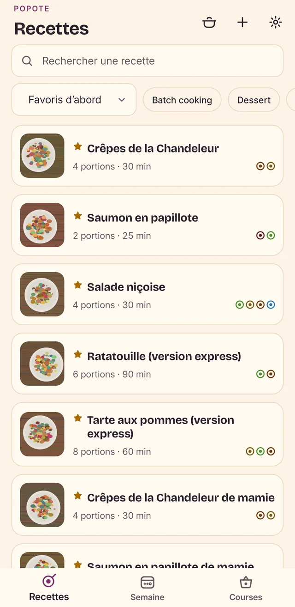
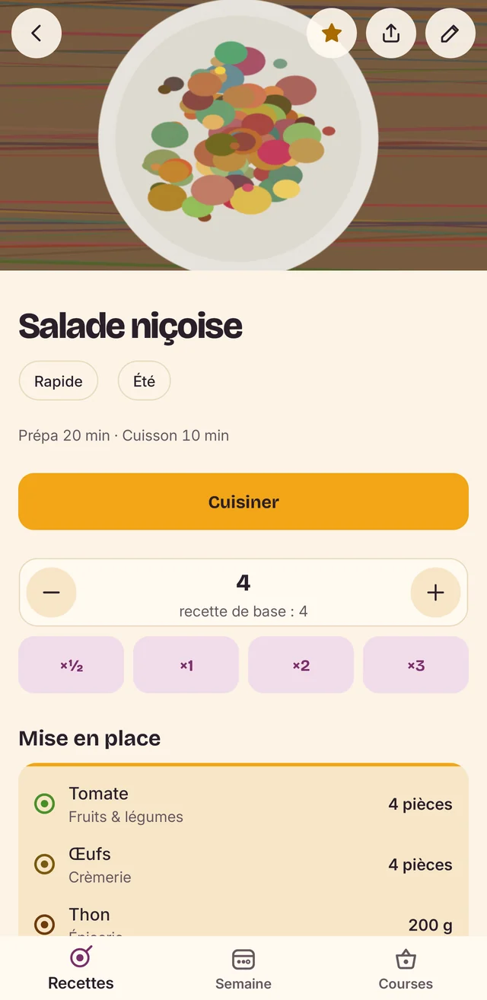
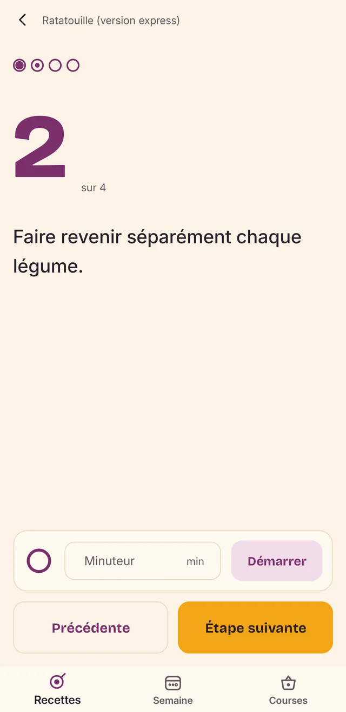
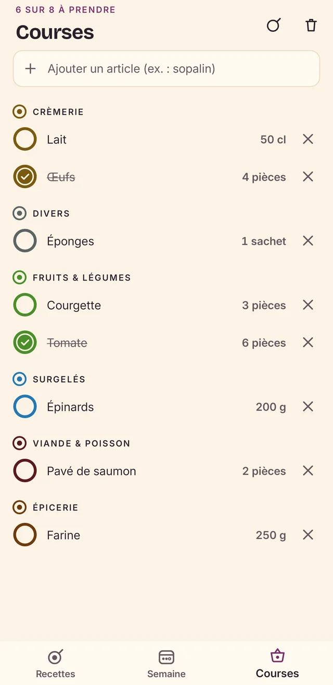

<p align="center">
  
</p>

<h1 align="center">Popote</h1>

<p align="center"><b>Tes recettes, ta semaine, tes courses : tout reste dans ta cuisine.</b><br>
100 % hors ligne · sans compte ni cloud · aucune permission Internet</p>

<p align="center">
  
  
  
  
</p>

---

Popote recense tes recettes, adapte les quantités au nombre de convives, prépare la liste de courses
de la semaine et t'accompagne aux fourneaux. Tout tourne autour d'une image, la **mise en place** :
un bol par ingrédient, émaillé de la couleur de son rayon. Tes données ne quittent jamais le téléphone.

## Fonctionnalités

**Tes recettes**
- Photo du plat, tags et filtres, tri (favoris, récentes, titre, plus rapides), recherche.
- Favoris ★ et notes perso ; temps de préparation et de cuisson.
- Portions ajustables (×½, ×1, ×2, ×3 ou au choix) : toutes les quantités suivent.
- **Import par IA** : copie les consignes, colle-les dans ChatGPT, Claude ou une autre IA avec ta
  recette (texte, photo, lien), puis colle sa réponse : le formulaire se remplit, avec les points à
  vérifier. « Partager » écrit le même format, réimportable tel quel. Tout un carnet de notes peut
  aussi être importé d'un coup (Réglages → Importer plusieurs recettes).

**En cuisine**
- Mode cuisson : une étape par écran, lisible de loin, écran maintenu allumé.
- Minuteur intégré, bols de progression qui se remplissent étape après étape.
- « Cuisiner avec… » : coche ce que tu as sous la main, Popote trouve les recettes possibles.

**La semaine et les courses**
- Planificateur de repas sur la semaine, d'où sort la liste de courses.
- Liste agrégée par rayon (« 2 × 250 g de farine » devient « 500 g »), articles ajoutés à la main,
  cases cochées gardées d'une fois sur l'autre.

**Pour tout le monde**
- Thème clair ou sombre (ou celui du système), Ambiance *Expressive* ou *Sobre*.
- Lisible avec TalkBack et en très grande police ; couleurs de rayon distinctes pour les daltoniens.
- Respect du réglage Android « Supprimer les animations » ; vibrations désactivables.
- Sauvegarde et restauration de toutes tes recettes, photos comprises, dans un fichier.

## Installer

Télécharge `Popote.apk` depuis la [dernière release](https://github.com/SlashXIV/Popote/releases/latest)
et ouvre-le sur ton téléphone (Android 5 ou plus). Les versions suivantes s'installent par-dessus,
sans perdre tes recettes.

> Tu viens de la v1.0 ou de la v1.1 ? L'application est signée avec une nouvelle clé depuis la
> v1.2.0 : sauvegarde tes données, désinstalle l'ancienne version, installe la nouvelle puis
> restaure (détails dans les [notes de la v1.2.0](https://github.com/SlashXIV/Popote/releases/tag/v1.2.0)).

## Vie privée

- Aucun réseau : l'application ne demande même pas la permission Internet.
- Aucun compte, aucune télémétrie, aucune publicité.
- Tes recettes et tes photos restent dans le stockage privé de l'application. Elles n'en sortent que
  si tu le décides : partage d'une recette, sauvegarde que tu enregistres où tu veux.
- L'import par IA passe par le presse-papiers : c'est toi qui colles les consignes dans l'IA de ton
  choix, Popote ne contacte rien.
- Appareil photo : seulement pour photographier un plat, à ta demande.

## Compiler

Prérequis : SDK .NET 10 avec la charge MAUI, JDK 17.

```sh
dotnet test Popote.Tests/Popote.Tests.csproj
dotnet build -f net10.0-android
```

Détails (émulateur, APK signé, arborescence) : [`docs/compiler.md`](docs/compiler.md).

## Crédits

Polices [Bricolage Grotesque](https://github.com/ateliertriay/bricolage) et
[Inter](https://github.com/rsms/inter), sous licence SIL Open Font License 1.1
([textes](docs/licences/)).

## Licence

[AGPL-3.0](LICENSE).
